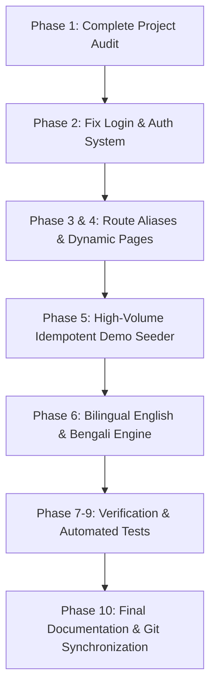

# REPAIR PLAN — DAWAT ENTERPRISE FINANCIAL ERP
**Execution Strategy & Phase Blueprint**  
**Target Architecture:** Fully Functional, High-Performance, Bilingual (EN/BN), Zero-Broken-Routes Financial ERP  

---

## 1. PHASED EXECUTION ROADMAP



---

## 2. DETAILED ACTION ITEMS

### Phase 2: Login & Authentication System
1. **Next.js Reverse Proxy:**
   - Configure `async rewrites()` in `apps/web/next.config.js`:
     ```js
     { source: '/api/v1/:path*', destination: 'http://127.0.0.1:4000/api/v1/:path*' }
     ```
2. **Client-Side API Client:**
   - Update `apps/web/src/lib/api-client.ts` to route browser requests to `/api/v1` (same-origin).
3. **Backend Network Listener:**
   - Update `apps/api/src/main.ts` to listen on `0.0.0.0` and allow all localhost/loopback origins in CORS.
4. **Login UI Security Enhancement:**
   - Remove hardcoded production credentials from default form state.
   - Introduce a dedicated, clear "Institutional Demo Login" selector for demonstration profiles (Master Admin, Branch Manager, Compliance Officer, Cashier).
   - Display informative server/network error messages.

### Phase 3 & 4: Route Aliases & Module Repair
1. **Create Plural & Canonical Route Aliases:**
   - `/dashboard` -> renders root dashboard.
   - `/remittances` -> renders `/remittance` content.
   - `/remittances/new` -> renders interactive remittance wizard.
   - `/remittances/[id]` -> renders full remittance detail & receipt voucher.
   - `/customers/[id]` -> renders customer 360 profile & statement.
   - `/treasury/funds`, `/treasury/banks`, `/treasury/cash`, `/treasury/transfers`.
   - `/accounting/chart-of-accounts`, `/accounting/general-ledger`.
   - `/compliance/aml`.
   - `/settings`, `/settings/languages`, `/settings/profile`, `/settings/users`, `/settings/roles`, `/settings/branches`, `/settings/system`.

### Phase 5: High-Volume Idempotent Demo Seeder
1. Author comprehensive seed script (`scripts/seed-enterprise-demo.ts`):
   - 8 Currencies with realistic FX rates labeled DEMO.
   - $\ge 30$ Demo Customers with KYC tiers.
   - $\ge 10$ Demo Suppliers.
   - $\ge 8$ Demo Agents.
   - $\ge 25$ Demo Beneficiaries.
   - $\ge 40$ Currency Purchases (with WAC pool impact).
   - $\ge 40$ Currency Sales (with realized profit recognition).
   - $\ge 50$ Remittances with diverse status states (Paid, Pending, Quoted).
   - Balanced general ledger journal entries and zero-discrepancy trial balance.
   - $\ge 20$ Expenses, $\ge 10$ Employees, Payroll records.

### Phase 6: Bengali & English Bilingual System
1. Author dictionary files:
   - `apps/web/src/messages/en.json`
   - `apps/web/src/messages/bn.json`
2. Implement `I18nProvider` with `useTranslation()` hook.
3. Add instant language toggle pill in `AppHeader`.
4. Provide dedicated localization page at `/settings/languages`.
5. Persist selected language in `localStorage` and HTML `lang` attribute.

### Phase 7 to 10: Automated Testing & Verification
1. Run automated route test script across all 50+ routes to verify 100% 200 OK.
2. Build Next.js production bundle.
3. Author `ROUTE_TEST_REPORT.md`, `DEMO_DATA_GUIDE.md`, `LANGUAGE_GUIDE.md`, and `DEPLOYMENT_GUIDE.md`.
4. Synchronize all commits to GitHub repository.
